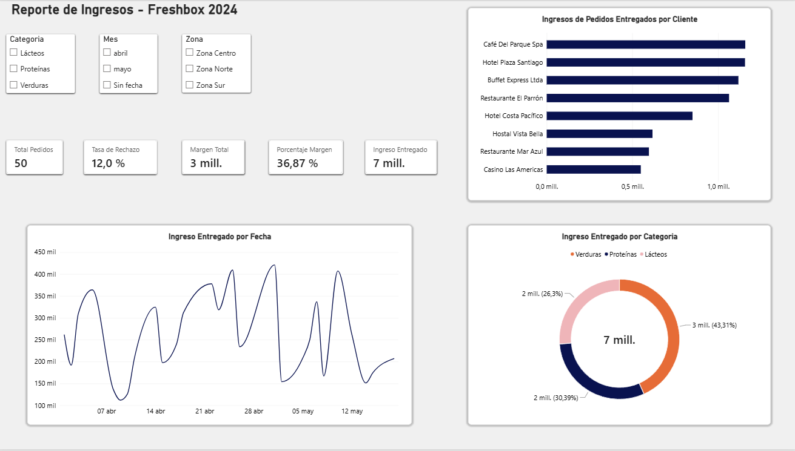
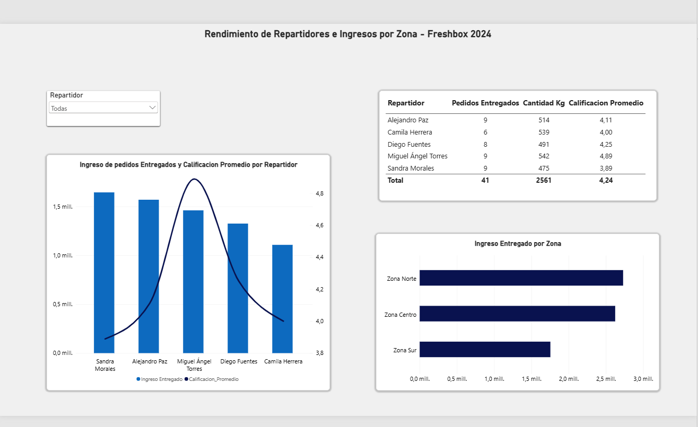
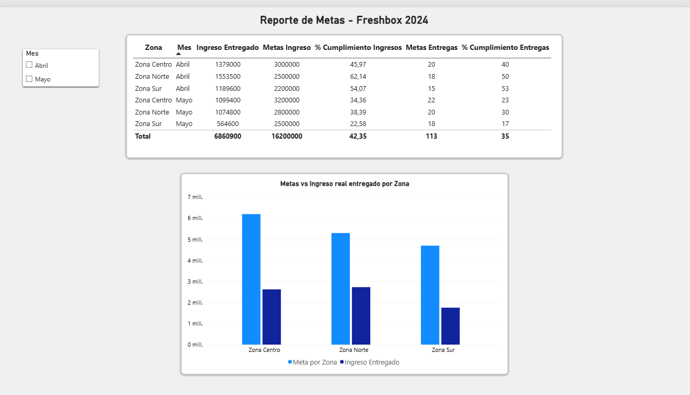

# 📦 Examen Integrador – FreshBox Chile

Caso de negocio simulado de una empresa de distribución de alimentos en Chile, desarrollado como examen integrador que abarca limpieza de datos, análisis SQL, visualización en Power BI e informe ejecutivo.

## 🗂️ Estructura del repositorio

| Archivo | Descripción |
|---------|-------------|
| `ExamenIntegrador_FreshBox.xlsx` | Datos limpios y Tabla Maestra con métricas calculadas (Ingreso, Costo Total, Margen, % Margen). Incluye tratamiento de valores nulos (PED-008, PED-015) |
| `freshbox_corregido.db` | Base de datos SQLite con 5 tablas: clientes, productos, repartidores, pedidos y metas |
| `consultas_freshbox.sql` | 10 consultas SQL analíticas (ingresos por producto, márgenes por repartidor, ranking de clientes, cumplimiento de metas, etc.) |
| `Freshbox.pbix` | Dashboard interactivo en Power BI con KPIs de cumplimiento, análisis por zona y tendencias mensuales |
| `INFORME EJECUTIVO FRESHBOX.docx` | Informe ejecutivo con hallazgos, cuantificación de impacto económico, alertas y recomendaciones |

## 🔧 Herramientas utilizadas

- **Excel** → Limpieza de datos, fórmulas condicionales, Tabla Maestra
- **SQL (SQLite)** → Consultas analíticas con JOIN, GROUP BY, HAVING, subqueries, CASE WHEN, funciones de ventana
- **Power BI** → Dashboard con visualizaciones interactivas y KPIs
- **Word** → Informe ejecutivo con análisis de negocio

## 🖥️ Dashboard en Power BI

El archivo `Freshbox.pbix` requiere Power BI Desktop. Estas son las tres páginas del dashboard:

### 1. Reporte de ingresos
KPIs generales (pedidos, tasa de rechazo, margen e ingreso entregado), ingreso por cliente, evolución diaria y distribución por categoría, con filtros por categoría, mes y zona.

### 2. Rendimiento de repartidores e ingresos por zona
Ingreso entregado y calificación promedio por repartidor, kilos y pedidos entregados, e ingreso por zona.

### 3. Reporte de metas
Cumplimiento de metas de ingreso y de entregas por zona y mes, y comparación entre meta e ingreso real.

## 📊 Hallazgos clave

- Cumplimiento de metas de ingreso: **42,4%** ($6.860.900 vs meta de $16.200.000)
- Cumplimiento de entregas: **36,3%** (41 de 113 metas acumuladas)
- Ingresos perdidos por rechazos: **$1.566.200** + $156.000 en flete
- Margen operativo total: **$2.507.250** (~36% sobre ingresos entregados)
- Lácteos con mayor tasa de rechazo (18,8%) vs Verduras (0%)
- Caída de ingresos abril→mayo: **-30%**

## 👤 Autor

Fabián Torres — Ingeniería Civil Industrial, UDP
